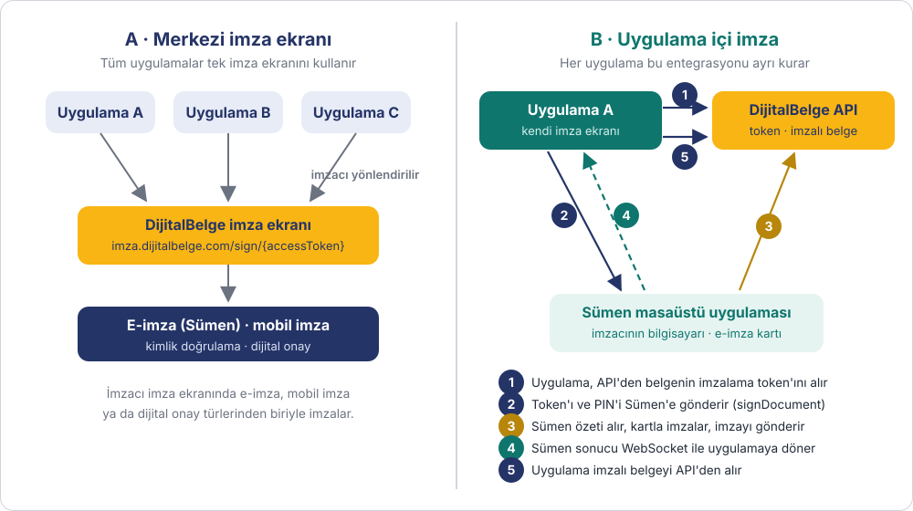
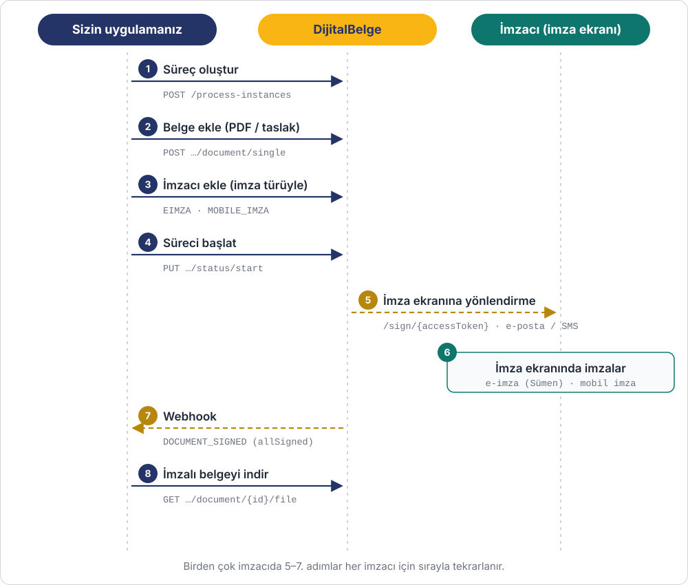
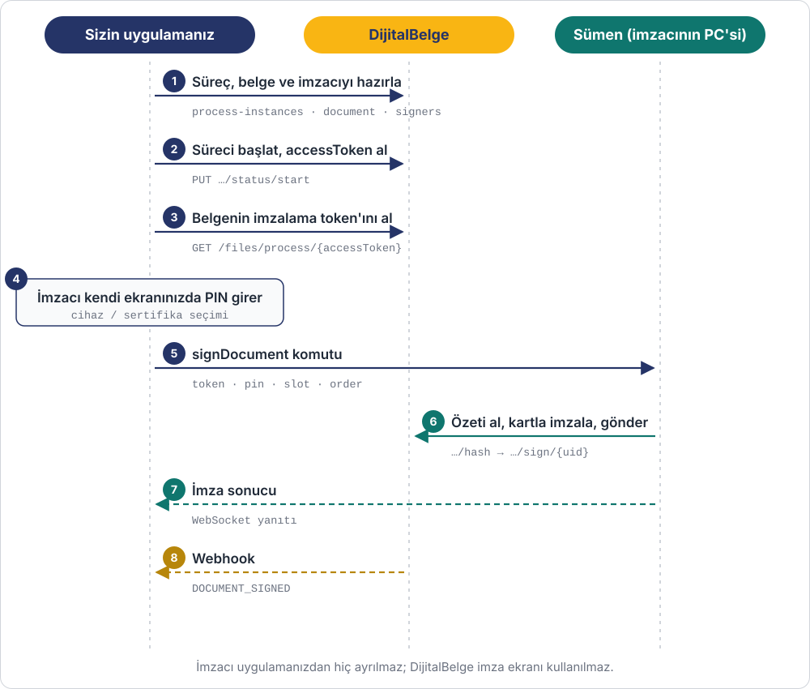
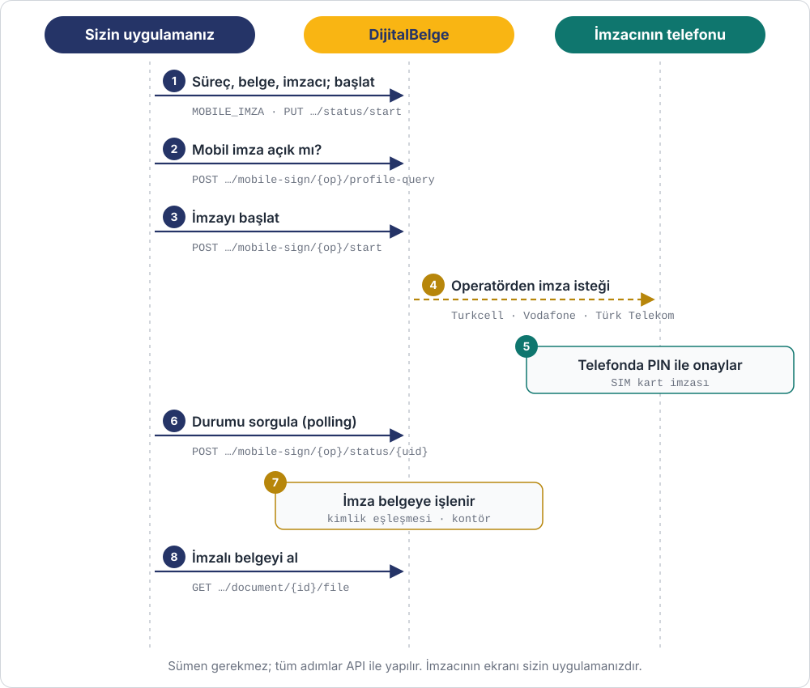

# Belge İmzalama

Belgelerinizi **nitelikli elektronik imzayla** imzalatırsınız. 5070 sayılı Elektronik
İmza Kanunu'na göre nitelikli elektronik imza, ıslak imzayla aynı hukuki sonucu doğurur.

**Kullanım örnekleri:** iş sözleşmesi, kira sözleşmesi, resmî yazışmalar, kurum içi onay
gerektiren belgeler, tedarikçi sözleşmeleri.

## İki entegrasyon modeli

İmzanın **nerede** atıldığına göre iki model vardır. Süreç, belge ve imzacı hazırlığı
iki modelde de aynıdır; fark imzacının imzayı hangi ekranda attığıdır.

| | A · Merkezi imza ekranı | B · Uygulama içi imza |
|---|---|---|
| **İmza nerede atılır** | DijitalBelge imza ekranında (`https://imza.dijitalbelge.com/sign/{accessToken}`) | Sizin uygulamanızın kendi ekranında |
| **İmzacı deneyimi** | Uygulamanızdan imza ekranına yönlendirilir ya da e-posta / SMS bağlantısıyla gelir | Uygulamanızdan hiç ayrılmaz |
| **Sizin geliştirmeniz** | Yalnızca API: süreç, belge, imzacı, webhook | API + kendi imza ekranınız; e-imzada ayrıca Sümen entegrasyonu |
| **Desteklenen imza türleri** | Tümü: e-imza, mobil imza, dijital onay türleri | E-imza (`EIMZA`, Sümen ile) ve mobil imza (`MOBILE_IMZA`, yalnızca API ile) |
| **Birden çok uygulamanız varsa** | Hepsi aynı imza ekranını kullanır; imza ekranı tek yerde güncellenir | Her uygulamada ayrı ayrı entegrasyon yapılır |
| **Ne zaman seçilir** | Hızlı entegrasyon, birden çok uygulama, farklı imza türleri | İmzanın kendi ürününüzün içinde, kesintisiz bir akışta atılması gerektiğinde |

!!! tip "Hangisiyle başlamalı?"
    Çoğu entegrasyon için **A · Merkezi imza ekranı** önerilir: daha az geliştirme
    gerektirir, tüm imza türlerini destekler ve imza ekranındaki iyileştirmeler
    uygulamalarınıza kendiliğinden yansır.

## İmza türleri

| Kod | Ad | İmzacının ihtiyacı |
|---|---|---|
| `EIMZA` | Elektronik İmza | Bilgisayarında takılı e-imza kartı / USB token ve [Sümen](../sumen-api.md) uygulaması |
| `MOBILE_IMZA` | Mobil İmza | Mobil imza özelliği açık SIM kart (Turkcell, Vodafone, Türk Telekom) |

Bir belgede birden çok imzacı olabilir ve her imzacıya ayrı tür verilebilir.
Örneğin şirket yetkilisi `EIMZA`, müşteri `MOBILE_IMZA` ile imzalayabilir.

---

## A · Merkezi imza ekranı

Uygulamanız süreci hazırlar ve imzacıyı DijitalBelge imza ekranına gönderir. İmza ekranının adresi
`https://imza.dijitalbelge.com/sign/{accessToken}` biçimindedir; `accessToken` süreç oluşturma ve
başlatma yanıtlarında döner. İmzacı bağlantıyı açtığında kod girmeden doğrudan belgeye ulaşır.
`https://imza.dijitalbelge.com` adresine doğrudan gelen kişiden ise erişim kodu istenir. İmza
ekranı e-imza, mobil imza ve dijital onay türlerinin hepsini kendisi yönetir.

| # | Ne yapılır | API | Ayrıntı |
|---|---|---|---|
| 1 | Süreç oluşturulur | `POST /process-instances` | [Süreç API](../progress.md) |
| 2 | Belge eklenir: PDF yüklenir ya da hazır bir taslaktan üretilir | `POST …/document/single` · `POST …/document/document-type` | [Döküman API](../documents.md) · [Taslaktan Döküman](../progress_doctype.md) |
| 3 | İmzacılar eklenir ve her birine imza türü verilir | `POST …/document/{documentId}/signers` | [İmzacı API](../signers.md) |
| 4 | Süreç başlatılır; yanıttaki `accessToken` saklanır | `PUT …/status/start` | [Süreç API](../progress.md) |
| 5 | İmzacı imza ekranına gelir: uygulamanızdaki "İmzala" butonuyla yönlendirilir ya da DijitalBelge'nin gönderdiği e-posta / SMS bağlantısıyla | `https://imza.dijitalbelge.com/sign/{accessToken}` | |
| 6 | İmzacı imza ekranında e-imza ya da mobil imza ile imzalar | — | |
| 7 | Her imzada webhook gelir; `allSigned: true` ise belgenin tüm imzacıları imzalamıştır | `DOCUMENT_SIGNED` | [Webhook](../webhook.md) |
| 8 | İmzalı belge indirilir | `GET …/document/{documentId}/file` | [Döküman API](../documents.md) |

---

## B · Uygulama içi imza

İmzacı uygulamanızdan ayrılmadan, sizin ekranınızda imzalar. Süreç, belge ve imzacı
hazırlığı A modeliyle aynıdır; imza anı ise tamamen `/external` API'si üzerinden yönetilir.

!!! info "Yetki"
    Uygulama içi imza uçları `embedded:signing` yetkisi ister. İmza yalnızca **başlatılmış**
    (`STARTED` / `IN_PROGRESS`) bir süreçte atılabilir. Belgeyi hangi imzacının imzaladığı,
    imzalayan sertifikadaki TC kimlik numarası belgenin bekleyen imzacısıyla eşleştirilerek
    belirlenir; eşleşmeyen sertifikayla imza reddedilir.

=== "E-imza (Sümen)"

    Uygulamanız belgenin **imzalama token'ını** API'den alır ve imzacının bilgisayarındaki
    [Sümen](../sumen-api.md) masaüstü uygulamasına `signDocument` komutuyla iletir. Sümen
    belgenin özetini DijitalBelge'den alır, e-imza kartıyla imzalar ve imzayı DijitalBelge'ye
    kendisi gönderir. Sonuç Sümen'den WebSocket mesajı olarak uygulamanıza döner; imzalı
    belgeyi API'den alırsınız.

    

    | # | Ne yapılır | API |
    |---|---|---|
    | 1 | Süreç oluşturulur, belge ve imzacı (`EIMZA`) eklenir | A modelindeki 1–3. adımlar |
    | 2 | Süreç başlatılır | `PUT /external/process-instances/{processId}/status/start` |
    | 3 | Belgenin imzalama token'ı alınır (72 saat geçerli) | `GET /external/process-instances/{processId}/document/{documentId}/signing-token` |
    | 4 | İmzacı sizin ekranınızda e-imza cihazını, sertifikasını seçer ve PIN'ini girer | Sümen `devices` |
    | 5 | Token ve PIN Sümen'e gönderilir | Sümen `signDocument` |
    | 6 | Sümen özeti alır, kartla imzalar, imzayı DijitalBelge'ye gönderir | (Sümen yapar) |
    | 7 | Sümen sonucu WebSocket ile uygulamanıza döner | `signDocumentResult` |
    | 8 | İmzalı belge alınır | `GET /external/process-instances/{processId}/document/{documentId}/file` |

    Uçtan uca istek ve yanıtlar: [Uygulama İçi E-imza](../examples/uygulama-ici-eimza.md).

=== "Mobil imza"

    Sümen gerekmez; imzanın her adımı API ile yapılır. Uygulamanız imzacının telefon
    numarasını ve TC kimlik numarasını alır, mobil imzanın açık olduğunu sorgular ve imza
    isteğini başlatır. İmzacı telefonuna gelen isteği PIN'iyle onaylar; uygulamanız durumu
    sorgular ve imza gelince belge kendiliğinden imzalanmış olur.

    

    | # | Ne yapılır | API |
    |---|---|---|
    | 1 | Süreç oluşturulur, belge ve imzacı (`MOBILE_IMZA`) eklenir, süreç başlatılır | A modelindeki 1–4. adımlar |
    | 2 | (İsteğe bağlı) Operatör listesi alınır | `GET /external/mobile-sign/operators` |
    | 3 | İmzacının hattında mobil imzanın açık olduğu sorgulanır | `POST /external/process-instances/{processId}/document/{documentId}/mobile-sign/{operator}/profile-query` |
    | 4 | İmza isteği başlatılır; yanıttaki `uid` ve `transactionId` saklanır | `POST …/mobile-sign/{operator}/start` |
    | 5 | Operatör imzacının telefonuna imza isteği gönderir; imzacı PIN ile onaylar | — |
    | 6 | Durum birkaç saniyede bir sorgulanır; imza geldiğinde belgeye işlenir | `POST …/mobile-sign/{operator}/status/{uid}` |
    | 7 | Webhook gelir, imzalı belge alınır | `DOCUMENT_SIGNED` · `GET …/document/{documentId}/file` |

    Uçtan uca istek ve yanıtlar: [Uygulama İçi Mobil İmza](../examples/uygulama-ici-mobil-imza.md).

!!! warning "İmzalama token'ını imzacıdan başkasına göstermeyin"
    İmzalama token'ı o belgeyi imzalama yetkisi taşır. Token'ı yalnızca imzacının oturumunda
    kullanın; log'a ya da URL'ye yazmayın.

---

## Diğer seçenekler

!!! info "PDF dışındaki dosyalar"
    Word, XML gibi PDF olmayan dosyalar için süreç tipi `DOSYA_IMZALAMA` seçilir; dosya
    değiştirilmeden ayrık imzalanır (CAdES / ASiC-E). Ayrıntılar: [Dosya İmzalama](../dosya-imzalama.md).

!!! tip "İnsan müdahalesi olmadan imza"
    Kurum adına sunucuda saklanan bir sertifikayla otomatik imza için
    [Bulut İmzalama (Autosign)](../autosign.md) sayfasına bakın.

## İmzayı doğrulama

İmzalı belge QR kodla, doğrulama sayfasına yüklenerek ya da API ile doğrulanır:
[Belge Doğrulama](../dogrulama/index.md).

## Örnekler

- [Karşılıklı Elektronik Sözleşme İmzalama](../examples/karsilikli-sozlesme-imzalama.md)
- [Abonelik Sözleşmesi İmzalama](../examples/abonelik-sozlesmesi.md) (Senaryo A)
- [Taslaktan Dinamik Süreç Başlatma](../examples/taslaktan-dinamik-surec.md)
