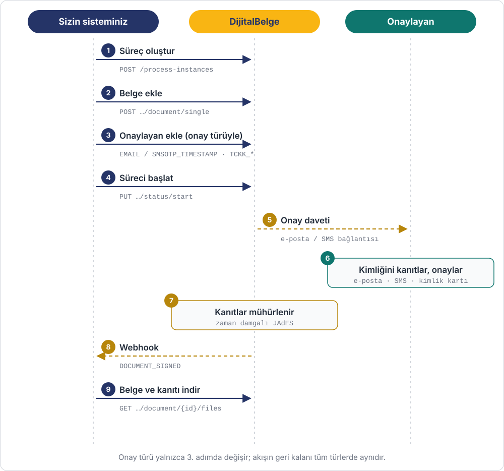

# Dijital Onay

Belgeniz, e-imzası olmayan kişilerce de onaylanabilir. Onaylayan kişi kimliğini
e-posta, SMS kodu ya da TC kimlik kartıyla kanıtlar; verdiği tüm kanıtlar
(SMS, konum, kimlik kartı çipi, yüz, video) **zaman damgasıyla mühürlenip** belgeye bağlanır.

Sonuç nitelikli elektronik imza değildir; ama **kimin, ne zaman, nereden, hangi
belgeyi onayladığı** sonradan değiştirilemez şekilde kanıtlanır.

**Kullanım örnekleri:** abonelik ve üyelik sözleşmeleri, sipariş / teklif onayı,
KVKK ve aydınlatma metni onayı, teslim tutanağı, uzaktan müşteri sözleşmeleri.

## Onay türleri

Akış her türde aynıdır; yalnızca 3. adımda onaylayana verilen tür değişir.
Tür yükseldikçe kanıt güçlenir.

| Kod | Ad | Onaylayanın yaptığı | Güvence |
|---|---|---|---|
| `EMAIL_TIMESTAMP` | E-Posta ile Dijital Onay | E-postadaki bağlantıdan onaylar | Düşük |
| `SMSOTP_TIMESTAMP` | SMS OTP ile Doğrulama | Telefonuna gelen kodu girer | Orta |
| `TCKK_TIMESTAMP` | Kimlik (TCKK) ile Dijital Onay | Kimlik kartını telefona okutur (NFC) + SMS + konum | Yüksek |
| `TCKK_FACE_TIMESTAMP` | TCKK ve Yüz Tanıma | Yukarıdakiler + yüzü kimlik kartı fotoğrafıyla karşılaştırılır | Çok yüksek |
| `TCKK_ONBOARDING` | TCKK + Yüz Tanıma Videolu | Yukarıdakiler + kimlik kartı fotoğrafı ve video kaydı | Çok yüksek+ |

Kimlik kartı gerektiren türlerde onay, DijitalBelge mobil uygulamasıyla yapılır.
Türlerin karşılaştırması ve kontör bilgisi: [İmzalama Türleri](../signature-types.md).

## Adımlar

| # | Ne yapılır | API | Ayrıntı |
|---|---|---|---|
| 1 | Süreç oluşturulur | `POST /process-instances` | [Süreç API](../progress.md) |
| 2 | Belge eklenir | `POST …/document/single` · `POST …/document/document-type` | [Döküman API](../documents.md) |
| 3 | Onaylayan eklenir ve onay türü seçilir | `POST …/document/{documentId}/signers` | [İmzacı API](../signers.md) |
| 4 | Süreç başlatılır | `PUT …/status/start` | [Süreç API](../progress.md) |
| 5 | DijitalBelge onaylayana e-posta / SMS ile bağlantı gönderir | — | |
| 6 | Onaylayan kimliğini kanıtlar ve belgeyi onaylar | — | |
| 7 | Kanıtlar zaman damgasıyla mühürlenir (JAdES kanıt dosyası) | — | [İmza Formatları](../signature-verification.md) |
| 8 | Webhook gelir | `DOCUMENT_SIGNED` | [Webhook](../webhook.md) |
| 9 | Onaylı belge ve kanıt dosyası indirilir | `GET …/document/{documentId}/files` | [Döküman API](../documents.md) |

!!! info "Kanıt dosyasını saklayın"
    Uyuşmazlık durumunda kanıt, onaylı PDF ile birlikte kanıt dosyasıdır (`.jades`).
    Dosya, onaylayanın gördüğü belgenin özetini ve verdiği tüm kanıtları içerir; herkese
    açık doğrulama sayfasında PDF ile birlikte doğrulanabilir.

## Örnekler

- [Abonelik Sözleşmesi İmzalama](../examples/abonelik-sozlesmesi.md) (Senaryo B: kimlik doğrulamalı onay)
- [İmzalama Türleri ve Senaryolar](../signature-types.md)
