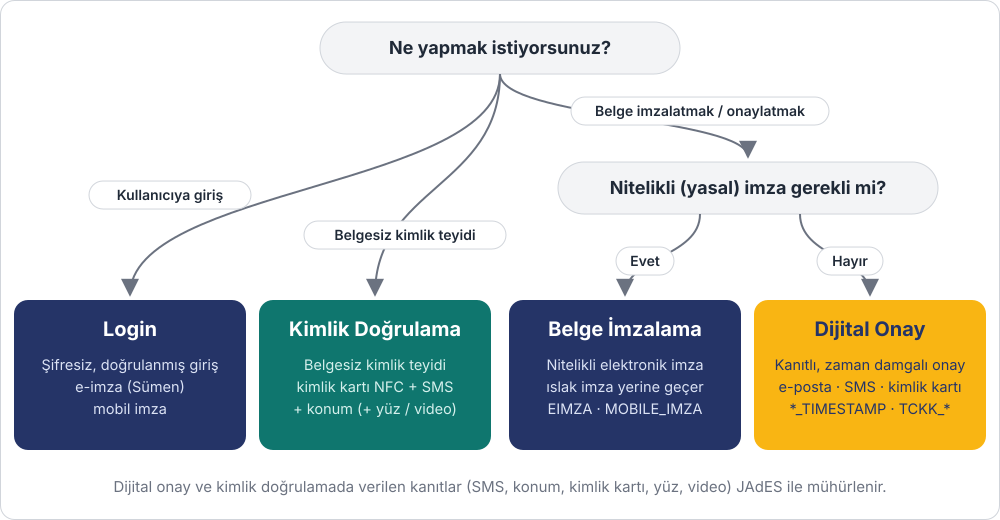

# Hangi akış size uygun?

DijitalBelge'yi dört farklı amaçla entegre edebilirsiniz. Her akışın kendi sayfası var:
önce aşağıdaki şemadan size uyanı seçin, sonra o sayfadaki adımları izleyin.

| Akış | Ne zaman kullanılır | Sonuç | Sayfa |
|---|---|---|---|
| **Belge İmzalama** | Sözleşme, dilekçe gibi belgelerin **ıslak imza yerine geçen** nitelikli elektronik imzayla imzalanması | İmzalı PDF (PAdES) ya da ayrık imzalı dosya (ASiC-E) | [Belge İmzalama](belge-imzalama.md) |
| **Dijital Onay** | Nitelikli imza gerekmeyen, ama **kimin, ne zaman, nereden onayladığının kanıtlanması** gereken belgeler | Onaylı PDF + zaman damgalı kanıt dosyası (JAdES) | [Dijital Onay](dijital-onay.md) |
| **Kimlik Doğrulama** | Belge olmadan, bir kişinin **gerçekten iddia ettiği kişi olduğunun** teyidi (üyelik, KYC) | Mühürlü kimlik doğrulama kanıtı | [Kimlik Doğrulama](kimlik-dogrulama.md) |
| **Login** | Kullanıcılarınızın sitenize **e-imza ya da mobil imza ile giriş** yapması | Doğrulanmış kimlikle oturum + audit log | [Login](login.md) |

!!! tip "Hepsi için ortak ön koşul"
    Tüm akışlarda istekler `X-Client-Id` ve `X-Client-Secret` başlıklarıyla yapılır.
    Bu bilgileri almak için [API Erişimi](../authentication.md) sayfasına bakın.
    Belge imzalama, dijital onay ve kimlik doğrulama akışlarında sonucu anında öğrenmek
    için bir [Webhook](../webhook.md) tanımlamanız önerilir.

## Akışları okuma rehberi

Akış şemalarında üç taraf vardır:

- **Sizin sisteminiz** (lacivert): DijitalBelge API'sini çağıran uygulamanız.
- **DijitalBelge** (sarı): süreci yöneten, bildirimleri gönderen, imzaları doğrulayan platform.
- **İmzacı / kullanıcı** (yeşil): belgeyi imzalayan, onaylayan ya da kimliğini doğrulayan kişi.

Düz oklar sizin yaptığınız API çağrılarıdır; kesikli oklar DijitalBelge'nin gönderdiği
bildirimleri (e-posta, SMS, webhook) gösterir. Her şemadaki numaralar, sayfadaki adım
tablosuyla birebir eşleşir.
