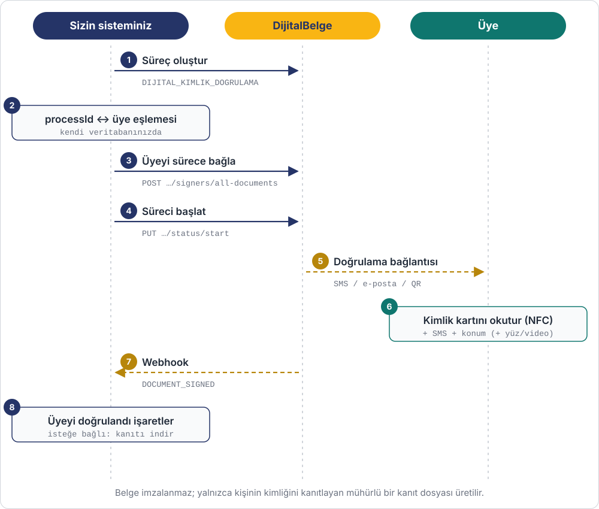

# Kimlik Doğrulama

Belge imzalatmadan, bir kişinin **gerçekten iddia ettiği kişi olduğunu** doğrularsınız.
Kişi TC kimlik kartını telefonuna okutur, SMS kodunu girer ve konum verir; sonuç
mühürlü bir kanıt dosyası olarak saklanır ve size webhook ile bildirilir.

**Kullanım örnekleri:** üyelik / hesap açılışında KYC, yüksek tutarlı işlem öncesi teyit,
satıcı hesabı başvurusu, araç ya da konut kiralama, yaş doğrulama.



!!! warning "Belge yüklenmez"
    Süreç tipi `DIJITAL_KIMLIK_DOGRULAMA` olduğunda hiçbir dosya yüklenmez. Kişiyi sürece
    bağladığınız çağrı (3. adım) gerekli iç belgeyi kendisi oluşturur.

## Doğrulama seviyeleri

| Kod | Kişinin yaptığı | Ne zaman |
|---|---|---|
| `TCKK_TIMESTAMP` | Kimlik kartı NFC + SMS + konum | Çoğu üyelik ve e-ticaret senaryosu |
| `TCKK_FACE_TIMESTAMP` | Yukarıdakiler + yüz eşleştirme | Kimlik kartının sahibinin kendisi olduğundan emin olunması gerektiğinde |
| `TCKK_ONBOARDING` | Yukarıdakiler + kimlik fotoğrafı ve video | Finans, kripto gibi en yüksek güvence gereken alanlar |

## Adımlar

| # | Ne yapılır | API | Ayrıntı |
|---|---|---|---|
| 1 | Süreç oluşturulur: `processType: DIJITAL_KIMLIK_DOGRULAMA` | `POST /process-instances` | [Süreç API](../progress.md) |
| 2 | Dönen `processId`, kendi sisteminizde üyeyle eşleştirilir | — | |
| 3 | Üye sürece bağlanır ve doğrulama seviyesi seçilir | `POST …/signers/all-documents` | [İmzacı API](../signers.md) |
| 4 | Süreç başlatılır | `PUT …/status/start` | [Süreç API](../progress.md) |
| 5 | DijitalBelge üyeye doğrulama bağlantısı gönderir (SMS / e-posta / QR) | — | |
| 6 | Üye mobil uygulamada kimlik kartını okutur, SMS kodunu girer, konum verir | — | |
| 7 | Webhook gelir | `DOCUMENT_SIGNED` | [Webhook](../webhook.md) |
| 8 | Üye hesabınızda "kimliği doğrulandı" olarak işaretlenir; isteğe bağlı olarak kanıt indirilir | `GET …/document/{documentId}/files` | [Döküman API](../documents.md) |

!!! tip "Kimlik kartı çipi nasıl doğrulanır?"
    Kartın çipi iki yolla doğrulanır: çipteki verinin devletçe imzalandığı (Passive
    Authentication) ve çipin kopya olmadığı (Active Authentication). İki doğrulamanın
    sonucu da kanıt dosyasına yazılır.

## Bireysel ve kurumsal doğrulama

Doğrulanan kişinin türü imzacı kaydındaki `signerType` alanından gelir
([İmzacı türleri](../signers.md#imzac-turleri)):

| Tür | Kim doğrulanır | İmzacı kaydı |
|---|---|---|
| Bireysel | Kendi adına işlem yapan kişi | `signerType: INDIVIDUAL` |
| Kurumsal | Bir kurum adına işlem yapan yetkili | `signerType: CORPORATE` + kurum (`institutionId` ya da `institutionTitle`, vergi no, vergi dairesi) |

Kurumsal doğrulamada da kişinin kimliği kendi TC kimlik kartıyla doğrulanır; hangi kurum adına
işlem yaptığı imzacı kaydındaki kurum bilgisinden gelir. Kurumun yetkiyi gösteren belgeleri
(imza sirküleri vb.) [ek belge](#ek-belge-isteme) olarak istenir.

## Ek belge isteme

Kimlik doğrulamanın yanında kişiden **ek belge** de istenebilir. İstenecek belgeler
bireysel ve kurumsal doğrulamada genelde farklıdır, örneğin:

| Tür | Örnek ek belgeler |
|---|---|
| Bireysel | İkametgâh belgesi, adres beyanı, gelir belgesi |
| Kurumsal | Vergi levhası, imza sirküleri, ticaret sicil gazetesi, yetki belgesi |

Ek belgeler bir **süreç taslağında** tanımlanır; bu yüzden ek belgeli doğrulama, süreci
sıfırdan oluşturmak yerine taslaktan başlatılarak yapılır:

1. **Taslakları hazırlayın (panelden, bir kez):** Bireysel ve kurumsal doğrulama için ayrı birer
   süreç taslağı oluşturun. Süreç tipini `DIJITAL_KIMLIK_DOGRULAMA` seçin ve istenecek belge
   türlerini ekleyin. Her belge için **yüklenmesi zorunlu** ve **onay gerekli** seçenekleri
   ayrı ayrı belirlenir.
2. **Doğru taslağı seçin:** Kişi bireyselse bireysel, kurumsalsa kurumsal taslağın ID'sini
   kullanın. Taslakları listelemek için: `GET /external/process-definitions`.
3. **Süreci başlatın:** İmzacıyı taslaktaki taraf tipine bağlayarak süreci taslaktan başlatın.

    ```http
    POST /api/external/process-definitions/{definitionId}/start
    ```

    ```json
    {
      "name": "Kurumsal Kimlik Doğrulama - Örnek Teknoloji A.Ş.",
      "autoStart": true,
      "signers": [ { "signerId": 138, "partyTypeId": 6 } ]
    }
    ```

4. **Kişi belgeleri yükler:** Doğrulama sırasında kimliğini doğrularken istenen belgeleri de yükler.
5. **Belgeleri inceleyin:** Onay gerektiren belgeler panelden onaylanır ya da reddedilir. Sonuç
   `DOCUMENT_APPROVED` webhook'uyla gelir (`status`: `APPROVED`, `REJECTED`, `REVOKED`).
6. **Belgeleri alın:** Yüklenen dosyalar `GET /external/process-instances/{processId}/document/{documentId}/files`
   ile listelenir ve indirilir.

!!! tip "Hesabı ne zaman doğrulanmış sayın?"
    Ek belge istenen doğrulamada kişiyi yalnızca kimlik doğrulaması (`DOCUMENT_SIGNED`) geldiğinde
    değil, onay gerektiren belgelerin hepsi `APPROVED` olduğunda doğrulanmış sayın.

Taslaktan süreç başlatmanın ayrıntıları: [Süreç Taslakları API](../process-definitions.md) ·
[Taslaktan Dinamik Süreç Başlatma](../examples/taslaktan-dinamik-surec.md).

## Örnek

Uçtan uca istek ve yanıtlarıyla: [Üyelik Kimlik Doğrulama](../examples/uyelik-kimlik-dogrulama.md).
