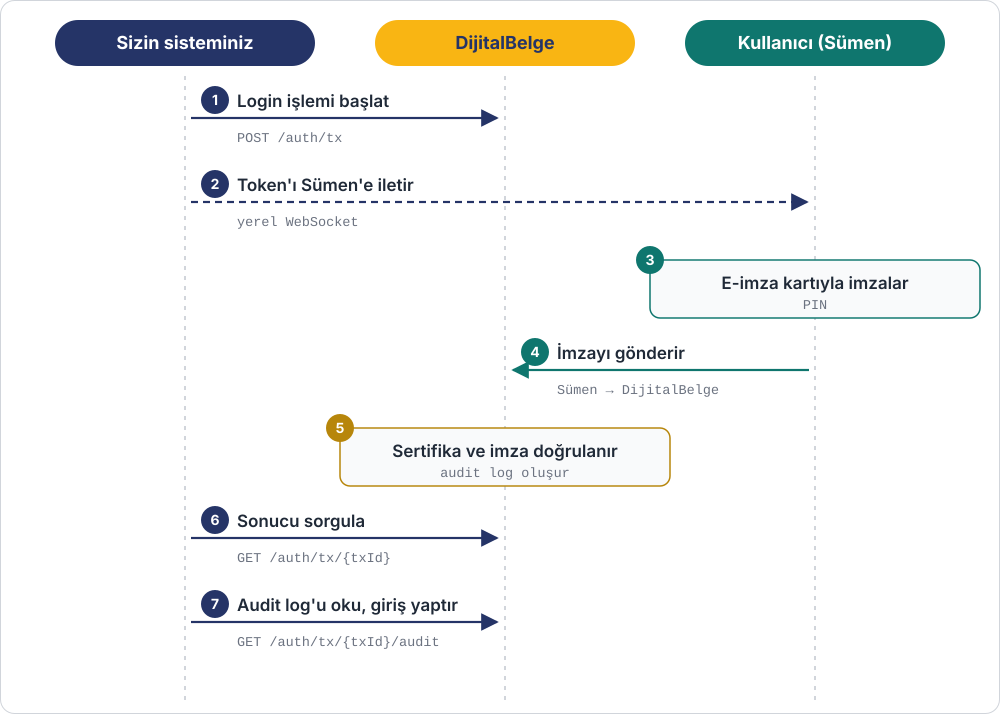
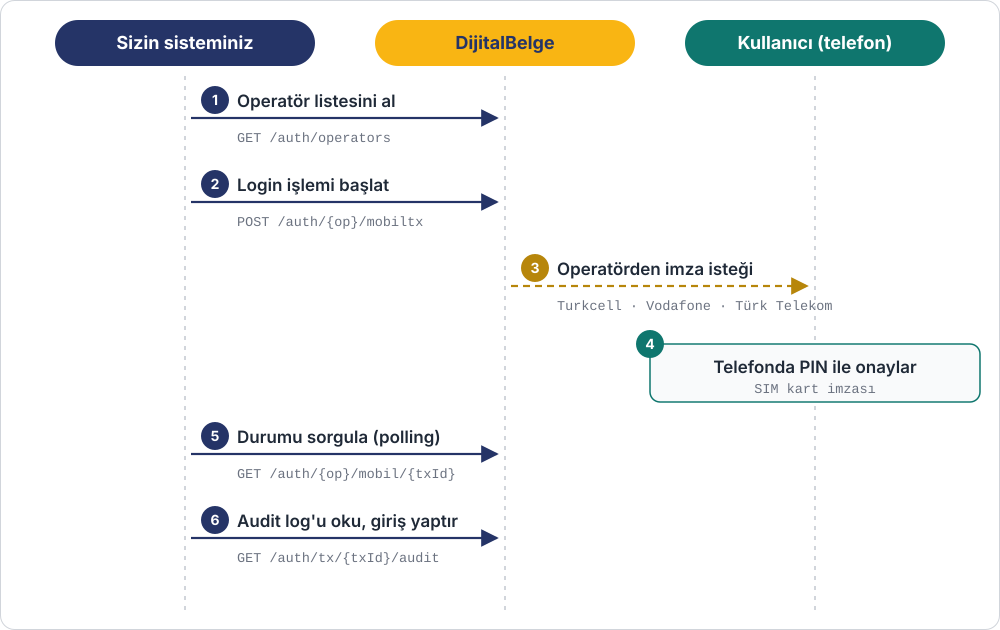

# Login

Kullanıcılarınız sitenize **şifre yerine e-imza ya da mobil imzayla** giriş yapar.
Giriş, nitelikli sertifikayla atılan bir imzaya dayandığı için kullanıcının kimliği
(TC kimlik no, ad soyad) kesin olarak doğrulanmış olur; her giriş için bir audit log tutulur.

**Kullanım örnekleri:** kamu ve belediye portalları, kurumsal bayi / tedarikçi
portalları, sağlık ve finans uygulamalarında güçlü kimlik doğrulama.

=== "E-imza ile login"

    Kullanıcının bilgisayarında e-imza kartı ve [Sümen](../sumen-api.md) uygulaması bulunur.
    Siteniz Sümen ile tarayıcı üzerinden, yerel WebSocket bağlantısıyla haberleşir.

    

    | # | Ne yapılır | API |
    |---|---|---|
    | 1 | Login işlemi başlatılır, geçici bir token alınır | `POST /external/auth/tx` |
    | 2 | Token, kullanıcının bilgisayarındaki Sümen'e iletilir | Sümen WebSocket |
    | 3 | Kullanıcı e-imza kartıyla (PIN) imzalar | — |
    | 4 | Sümen imzayı DijitalBelge'ye gönderir | — |
    | 5 | Sertifika ve imza doğrulanır, audit log oluşur | — |
    | 6 | Sonuç sorgulanır | `GET /external/auth/tx/{loginTxId}` |
    | 7 | Audit log okunur ve kullanıcı giriş yaptırılır | `GET /external/auth/tx/{loginTxId}/audit` |

    Ayrıntılar: [E-İmza Login API](../esign.md) · [Sümen API](../sumen-api.md)

=== "Mobil imza ile login"

    Kullanıcının telefonunda mobil imza özelliği açık bir SIM kart bulunur; ek uygulama gerekmez.

    

    | # | Ne yapılır | API |
    |---|---|---|
    | 1 | Desteklenen operatörler alınır | `GET /external/auth/operators` |
    | 2 | Login işlemi başlatılır | `POST /external/auth/{operator}/mobiltx` |
    | 3 | Operatör kullanıcının telefonuna imza isteği gönderir | — |
    | 4 | Kullanıcı telefonunda PIN ile onaylar | — |
    | 5 | Durum sorgulanır (polling) | `GET /external/auth/{operator}/mobil/{loginTxId}` |
    | 6 | Audit log okunur ve kullanıcı giriş yaptırılır | `GET /external/auth/tx/{loginTxId}/audit` |

    Ayrıntılar: [Mobil İmza Login API](../mobilsign.md)

!!! warning "Girişi her zaman sunucu tarafında doğrulayın"
    Kullanıcıyı giriş yaptırmadan önce audit log'u kendi sunucunuzdan, `X-Client-Secret`
    ile okuyun. Tarayıcıdan gelen "başarılı" bilgisine tek başına güvenmeyin.
