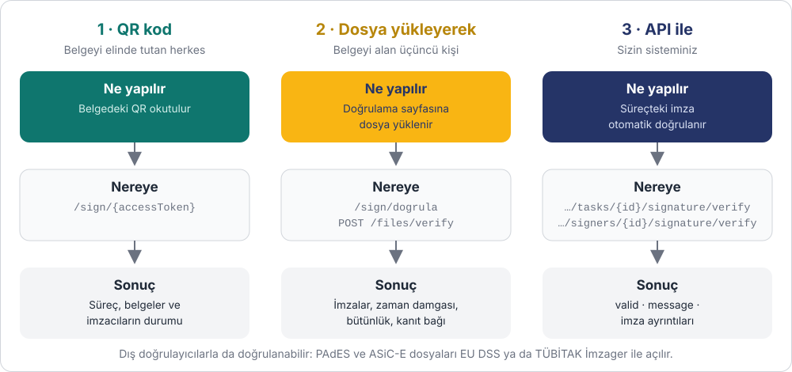

# Belge Doğrulama

DijitalBelge'de imzalanan ya da onaylanan her belge sonradan doğrulanabilir: imzanın
geçerli olduğu, belgenin imzadan sonra değiştirilmediği ve imzanın kime, hangi tarihte
ait olduğu kontrol edilir. Doğrulama için dört yol vardır.

| Yol | Kim kullanır | Nasıl | Giriş gerekir mi |
|---|---|---|---|
| **1 · QR kod** | Belgenin basılı ya da PDF halini elinde tutan herkes | Belgedeki QR okutulur, sürecin sayfası açılır | Hayır |
| **2 · Dosya yükleyerek** | Belgeyi e-posta ile alan karşı taraf, denetçi, mahkeme | Dosya [doğrulama sayfasına](https://imza.dijitalbelge.com/sign/dogrula) yüklenir | Hayır (resimli doğrulama kodu ile) |
| **3 · Süreçteki imzalar** | Sizin sisteminiz | DijitalBelge'de başlattığınız süreçteki imza, dosya göndermeden doğrulanır | Evet (`X-Client-Id`, `document:read`) |
| **4 · Doğrulama API** | Sizin sisteminiz | Herhangi bir imzalı dosya (PAdES, ASiC-E, PDF + JAdES, JAdES, CAdES, XAdES) gönderilir; süreçle ilişkisi yoktur | Evet (`X-Client-Id`, `verify:document`) |

---

## 1 · QR kod

Her sürecin belgeye basılabilen bir doğrulama QR kodu vardır. QR, sürecin sayfasını
(`https://imza.dijitalbelge.com/sign/{accessToken}`) açar; burada belgeler, imzacılar ve
her imzanın durumu görünür.

QR'ın PNG görselini kendi ekranınızda göstermek için:
`GET /process-instances/{processId}/qr` ([Süreç API](../progress.md)).

## 2 · Dosya yükleyerek

Belgeyi alan kişi, hesap açmadan
[imza.dijitalbelge.com/sign/dogrula](https://imza.dijitalbelge.com/sign/dogrula) sayfasına
dosyayı yükleyerek doğrular. Sayfa, yüklenen dosyanın türüne göre şunları kontrol eder:

| Doğrulama türü | Yüklenen | Ne kontrol edilir |
|---|---|---|
| `PDF` | İmzalı PDF | PDF'teki e-imza ve zaman damgaları: geçerlilik, sertifika zinciri, imzadan sonra değişiklik |
| `PDF_JADES` | PDF + kanıt dosyası (`.jades`) | Kanıtın bu PDF'e ait olduğu; kanıttaki SMS, konum, kimlik kartı, yüz ve video bilgileri |
| `ASICE` | `.asice` container | Container imzası ve içindeki her dosyanın bütünlüğü |
| `JADES` | Yalnızca kanıt dosyası | Kanıt mührünün geçerliliği ve zaman damgası |

Aynı kontrol API'den de yapılabilir: `POST /files/verify` (girişsiz; resimli doğrulama kodu
`GET /public/sign/captcha` ile alınır). Ayrıntılar:
[İmza Formatları ve Doğrulama](../signature-verification.md).

!!! tip "Dijital onayda iki dosya birlikte doğrulanır"
    E-posta, SMS ya da kimlik kartıyla onaylanan belgelerde kanıt PDF'in içinde değil,
    ayrı bir `.jades` dosyasındadır. Karşı tarafa onaylı PDF ile birlikte kanıt dosyasını da
    gönderin; `PDF_JADES` türüyle ikisi birlikte doğrulanır.

## 3 · Süreçteki imzalar

DijitalBelge'de başlattığınız bir sürecin imzalarını, dosya göndermeden, süreç ve imzacı
kimlikleriyle doğrularsınız. Yanıt her durumda aynı yapıdadır: `valid`, `message` ve imza ayrıntıları.

| Ne zaman | API |
|---|---|
| İmzacı ID'sini biliyorsanız | `GET …/process-instances/{processId}/signers/{signerId}/signature/verify` |
| Belge ve görev ID'sini biliyorsanız | `GET …/process-instances/{processId}/document/{documentId}/tasks/{taskId}/signature/verify` |

Ayrıntılar ve yanıt alanları: [İmza Formatları ve Doğrulama](../signature-verification.md#dogrulama-endpointleri).

## 4 · Doğrulama API

Elinizdeki herhangi bir imzalı dosyayı API anahtarınızla doğrularsınız; dosyanın
DijitalBelge'de imzalanmış ya da bir süreçte yer alıyor olması gerekmez. Başka bir
sistemden gelen e-imzalı PDF'ler, `.p7s` (CAdES) ve imzalı XML (XAdES, ör. e-Reçete, e-Fatura)
dosyaları da doğrulanır.

| Format | API |
|---|---|
| PAdES (imzalı PDF) | `POST /external/verify/pades` |
| ASiC-E | `POST /external/verify/asice` |
| PDF + JAdES | `POST /external/verify/pdf-jades` |
| JAdES | `POST /external/verify/jades` |
| CAdES (`.p7s`, gömülü ya da ayrık) | `POST /external/verify/cades` |
| XAdES (gömülü ya da ayrık) | `POST /external/verify/xades` |

Ayrıntılar, örnekler ve geçerlilik kuralları: [Doğrulama API](api.md).

---

## Hangi belgede ne doğrulanır?

| Belge nasıl imzalandı | Ortaya çıkan dosya | Doğrulama |
|---|---|---|
| E-imza / mobil imza ile ([Belge İmzalama](../akislar/belge-imzalama.md)) | İmzalı PDF (PAdES) | PDF tek başına doğrulanır; Adobe Reader, EU DSS ve TÜBİTAK İmzager de açabilir |
| E-imza / mobil imza ile, PDF dışı dosyalar | `.asice` container | Container tek başına doğrulanır; EU DSS ve İmzager de açabilir |
| Dijital onay türleriyle ([Dijital Onay](../akislar/dijital-onay.md)) | Zaman damgalı PDF + `.jades` kanıt | PDF ve kanıt birlikte (`PDF_JADES`) |
| Kimlik doğrulama ([Kimlik Doğrulama](../akislar/kimlik-dogrulama.md)) | Yalnızca `.jades` kanıt | Kanıt tek başına (`JADES`) |
