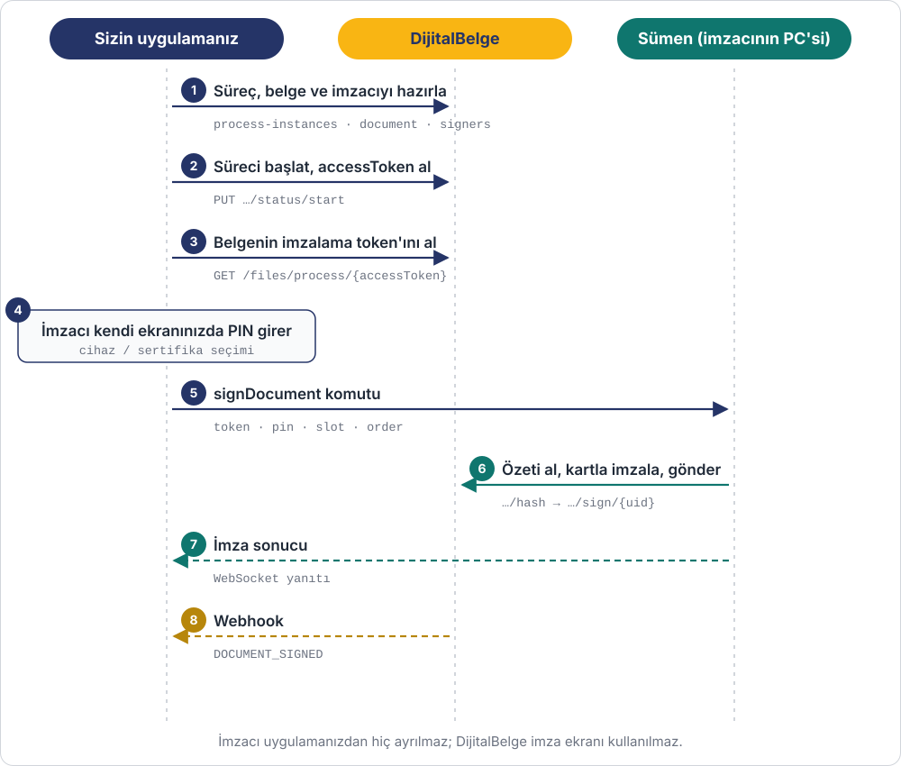

# Uygulama İçi E-imza

Bu senaryoda imzacı belgeyi **sizin uygulamanızın ekranında** e-imza kartıyla imzalar.
Uygulamanız DijitalBelge API'sinden belgenin imzalama token'ını alır ve imzacının
bilgisayarındaki **Sümen masaüstü uygulamasına** iletir. Sümen imzayı atıp DijitalBelge'ye
gönderir, sonucu WebSocket ile uygulamanıza bildirir.

**Senaryo:** Bir İK yazılımında yönetici, onay bekleyen iş sözleşmesini yazılımın kendi
ekranında açar, e-imza kartını seçer, PIN'ini girer ve yazılımdan çıkmadan imzalar.



## Ön koşullar

- API uygulamanızda `process:start`, `document:write`, `document:sign`, `document:read` ve
  **`embedded:signing`** yetkileri olmalı.
- İmzacının bilgisayarında [Sümen](../sumen-api.md) kurulu ve çalışır olmalı; e-imza kartı
  takılı olmalı.
- Uygulamanız Sümen'e tarayıcıdan, yerel WebSocket ile bağlanır.

## Adım 1 – Süreci hazırla ve başlat

İmzacı `EIMZA` türüyle bağlanır; geri kalanı [A modeli](../akislar/belge-imzalama.md#a-merkezi-imza-ekran) ile aynıdır:

```http
POST /api/external/process-instances
POST /api/external/process-instances/{processId}/document/single
POST /api/external/process-instances/{processId}/document/{documentId}/signers
PUT  /api/external/process-instances/{processId}/status/start
```

Bu senaryoda `processId = 512`, `documentId = 8801`.

## Adım 2 – İmzalama token'ını al

```bash
curl https://app.dijitalbelge.com/api/external/process-instances/512/document/8801/signing-token \
  -H "X-Client-Id: app_xxxxx" -H "X-Client-Secret: secret_xxxxx"
```

```json
{
  "processId": 512,
  "documentId": 8801,
  "token": "eyJhbGciOiJIUzI1NiJ9...",
  "expiresInSeconds": 259200
}
```

Token 72 saat geçerlidir ve **yalnızca bu belgeyi** imzalamaya yarar. Token'ı sunucunuzdan
alıp yalnızca imzacının oturumuna verin.

## Adım 3 – Cihaz ve sertifika seçimi

Uygulamanız Sümen'den imzacının bilgisayarındaki e-imza cihazlarını ve sertifikalarını ister
(`devices` komutu, [Sümen API](../sumen-api.md)). İmzacı cihazını ve sertifikasını seçip
PIN'ini girer; seçilen cihazın sırası `slot`, sertifikanın sırası `order` olur.

## Adım 4 – Sümen'e imzalat

```javascript
const ws = new WebSocket("ws://localhost:5134/ws");
ws.onopen = () => ws.send(JSON.stringify({
  requestId: "req_8k2m1x",
  command: "signDocument",
  token: signingToken,   // Adım 2
  pin: pin,              // imzacının girdiği PIN
  slot: 0,
  order: 0
}));
ws.onmessage = (e) => {
  const msg = JSON.parse(e.data);
  if (msg.type !== "signDocumentResult") return;
  if (msg.error) showError(msg.error.message ?? msg.error);   // örn. SIGNER_NOT_MATCHED
  else onSigned();                                            // Adım 5
};
```

Sümen bu komutta belgenin özetini DijitalBelge'den alır, kartla imzalar ve imzayı
DijitalBelge'ye gönderir. Belge içeriği uygulamanızdan geçmez. Hata kodları:
[Sümen API · signDocument](../sumen-api.md#4-sign-document-belge-imzalama).

## Adım 5 – İmzalı belgeyi al

Sümen başarılı sonucu döndüğünde (ya da `DOCUMENT_SIGNED` webhook'u geldiğinde) imzalı
PDF'i alın:

```http
GET /api/external/process-instances/512/document/8801/file
```

## Hatalar

| Nerede | Kod | Ne zaman |
|---|---|---|
| `signing-token` | `404` | Süreç hesabınıza ait değil ya da belge bu sürece ait değil |
| `signing-token` | `409` | Süreç başlatılmamış ya da tamamlanmış |
| `signing-token` | `403` | Uygulamanızda `embedded:signing` yetkisi yok |
| Sümen | `SIGNER_NOT_MATCHED` | Seçilen sertifika belgenin bekleyen `EIMZA` imzacısına ait değil |
| Sümen | `INSUFFICIENT_CREDIT` | Kontör yetersiz |

## İlgili kaynaklar

- [Belge İmzalama · Uygulama içi imza](../akislar/belge-imzalama.md#b-uygulama-ici-imza)
- [Uygulama İçi Mobil İmza](uygulama-ici-mobil-imza.md)
- [Sümen API](../sumen-api.md)
