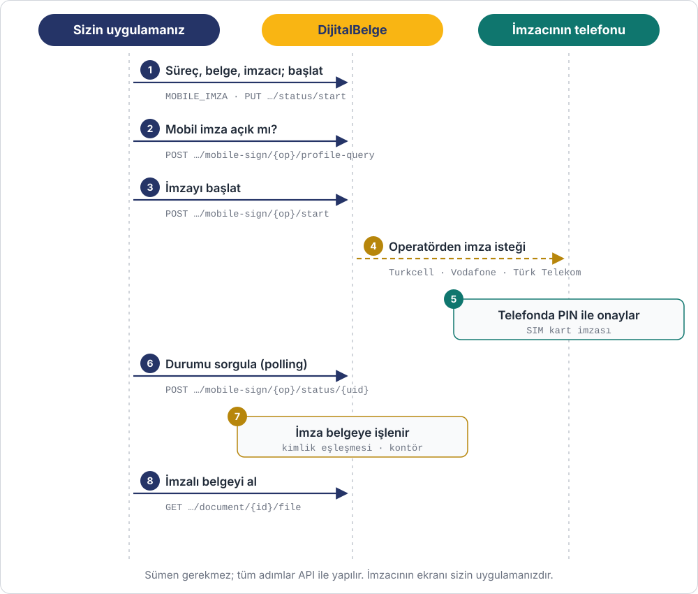

# Uygulama İçi Mobil İmza

Bu senaryoda imzacı belgeyi **sizin uygulamanızın ekranında** mobil imzayla imzalar.
Sümen ya da DijitalBelge imza ekranı kullanılmaz; tüm adımlar `/external` API'si ile yapılır.

**Senaryo:** Bir sigorta şirketinin mobil uygulamasında müşteri poliçe sözleşmesini görür,
"Mobil İmza ile İmzala" butonuna basar, telefonuna gelen isteği PIN'iyle onaylar ve
uygulamadan çıkmadan imzalı sözleşmeyi alır.



## Ön koşullar

- API uygulamanızda `process:start`, `document:write`, `document:sign`, `document:read` ve
  **`embedded:signing`** yetkileri olmalı.
- İmzacının cep telefonu numarası ve TC kimlik numarası. Mobil imza sertifikası bu TC kimlik
  numarasına ait olmalı.
- Hesabınızda kontör bulunmalı (imza başına 1 kontör).

## Adım 1 – Süreci hazırla ve başlat

Süreç oluşturulur, belge eklenir, imzacı `MOBILE_IMZA` türüyle bağlanır ve süreç başlatılır.
Bu adımlar [Belge İmzalama · A modeli](../akislar/belge-imzalama.md#a-merkezi-imza-ekran)
ile aynıdır:

```http
POST /api/external/process-instances
POST /api/external/process-instances/{processId}/document/single
POST /api/external/process-instances/{processId}/document/{documentId}/signers
PUT  /api/external/process-instances/{processId}/status/start
```

Bu senaryoda `processId = 512`, `documentId = 8801`.

## Adım 2 – Mobil imza açık mı?

Operatör yolda küçük harfle verilir: `turkcell`, `vodafone` ya da `turktelekom`.

```bash
curl -X POST https://app.dijitalbelge.com/api/external/process-instances/512/document/8801/mobile-sign/turkcell/profile-query \
  -H "X-Client-Id: app_xxxxx" -H "X-Client-Secret: secret_xxxxx" \
  -H "Content-Type: application/json" \
  -d '{ "msisdn": "905321234567", "identityNumber": "12345678901" }'
```

```json
{
  "success": true,
  "msisdn": "905321234567",
  "operator": "TURKCELL",
  "mobileSignatureEnabled": true
}
```

`mobileSignatureEnabled: false` ise imzacının hattında mobil imza yoktur; kullanıcıya bunu
gösterin ya da başka bir imza yöntemine yönlendirin.

## Adım 3 – İmzayı başlat

```bash
curl -X POST https://app.dijitalbelge.com/api/external/process-instances/512/document/8801/mobile-sign/turkcell/start \
  -H "X-Client-Id: app_xxxxx" -H "X-Client-Secret: secret_xxxxx" \
  -H "Content-Type: application/json" \
  -d '{ "msisdn": "905321234567", "identityNumber": "12345678901" }'
```

```json
{
  "success": true,
  "operator": "TURKCELL",
  "msisdn": "905321234567",
  "transactionId": "TX-9f2c41",
  "uid": "3f6c1e0a-1b2d-4c5e-8f90-a1b2c3d4e5f6"
}
```

Yanıttaki **`uid`** ve **`transactionId`** değerlerini saklayın; durum sorgusunda ikisi de
gerekir. Bu sırada imzacının telefonuna, belgeyi tanıtan bir metinle imza isteği gelir.

## Adım 4 – Durumu sorgula

İmzacı PIN'i girene kadar durumu 3–5 saniyede bir sorgulayın (en fazla 2 dakika):

```bash
curl -X POST https://app.dijitalbelge.com/api/external/process-instances/512/document/8801/mobile-sign/turkcell/status/3f6c1e0a-1b2d-4c5e-8f90-a1b2c3d4e5f6 \
  -H "X-Client-Id: app_xxxxx" -H "X-Client-Secret: secret_xxxxx" \
  -H "Content-Type: application/json" \
  -d '{ "transactionId": "TX-9f2c41" }'
```

İmza henüz gelmediyse `base64Signature` boş döner, sorgulamaya devam edin:

```json
{ "success": false, "status": "PENDING", "base64Signature": "" }
```

İmza geldiğinde belge **bu çağrının içinde** imzalanır ve `success: true` döner:

```json
{ "success": true, "status": "SIGNED", "transactionId": "TX-9f2c41", "msisdn": "905321234567" }
```

| `status` | Anlamı | Ne yapmalı |
|---|---|---|
| `PENDING` | İmzacı henüz onaylamadı | Sorgulamaya devam edin |
| `SIGNED` / `COMPLETED` | İmza alındı, belge imzalandı | Adım 5 |
| `REJECTED` / `CANCELLED` | İmzacı isteği reddetti | Kullanıcıya bildirin; isterse Adım 3'ü tekrarlayın |
| `EXPIRED` | İmzacı süresinde onaylamadı | Adım 3'ü tekrarlayın |
| `ERROR` | Operatör hatası | `errorDescription` alanına bakın |

!!! warning "Sertifika imzacıyla eşleşmeli"
    Mobil imza sertifikasındaki TC kimlik numarası belgenin bekleyen `MOBILE_IMZA`
    imzacısıyla eşleşmiyorsa imza belgeye işlenmez ve hata döner.

## Adım 5 – İmzalı belgeyi al

Webhook ile `DOCUMENT_SIGNED` gelir. İmzalı PDF:

```http
GET /api/external/process-instances/512/document/8801/file
```

## Hatalar

| Kod | Ne zaman |
|---|---|
| `404` | Süreç hesabınıza ait değil ya da belge bu sürece ait değil |
| `409` | Süreç başlatılmamış / tamamlanmış, ya da kontör yetersiz |
| `400` | `msisdn`, `identityNumber` ya da `transactionId` eksik; operatör adı geçersiz |
| `403` | Uygulamanızda `embedded:signing` yetkisi yok |

## İlgili kaynaklar

- [Belge İmzalama · Uygulama içi imza](../akislar/belge-imzalama.md#b-uygulama-ici-imza)
- [Uygulama İçi E-imza](uygulama-ici-eimza.md)
- [Webhook](../webhook.md)
